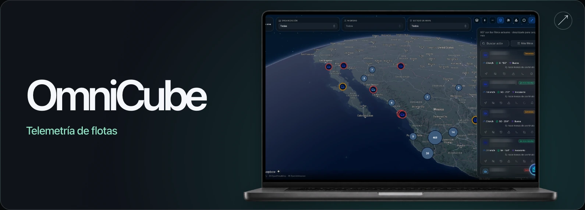

# OmniCube

Mapa de flotas en vivo, telemetría por vehículo e historial de recorridos.

<a href="https://clyra.dev/portfolio/omnicube">
  <picture>
    <source media="(max-width: 650px)" srcset="./media/movil.webp">
    
  </picture>
</a>

Desde el mapa puedes pasar de toda la flota a una unidad y consultar su posición y telemetría. Las rutas, geocercas y alertas ayudan a reconstruir un recorrido. El panel de operaciones reúne la actividad y el estado de conexión de las unidades.

[**Explora el proyecto**](https://clyra.dev/portfolio/omnicube)　·　[Galería de pantallas](https://clyra.dev/portfolio/omnicube#project-gallery)　·　[Estudio Clyra](https://clyra.dev/)
